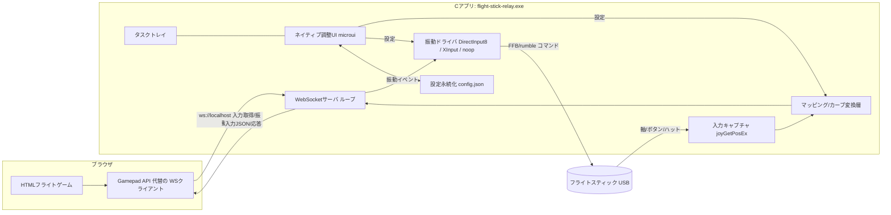
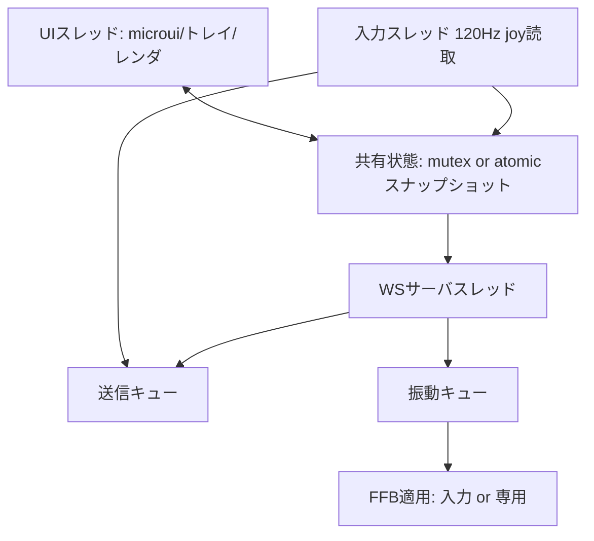

# Flight Stick Relay - 詳細設計

C言語でUSBフライトスティックの入力を取得し、`ws://localhost` 経由でHTMLフライトゲームへ指示を送る双方向中継アプリ。被弾・失速などのイベントをゲームから受け取り、スティックの振動（FFB/rumble）を駆動する。調整用ネイティブGUIを内蔵し、タスクトレイ常駐でブラウザ非依存。

## 1. 確定した前提（grill 済み）

| 項目 | 決定 |
|---|---|
| ゲーム実行環境 | ブラウザ（Chrome/Edge）、HTMLゲーム |
| Cアプリの役割 | ローカルWebSocketサーバ（`ws://localhost`）として双方向中継 |
| 入力取得 | MultiMedia Joystick（`joyGetPosEx`）: 軸・ボタン・ハット |
| 振動出力 | 接続済み振動対応スティックそのものを駆動（DirectInput8 FFB / XInput rumble / no-op フォールバック） |
| 調整UI | ネイティブGUI（microui + OpenGL3 推奨）。タスクトレイ常駐、ブラウザ非依存 |
| 設定反映 | 同一WebSocketでリアルタイム反映、設定は `config.json` に永続化 |

## 2. コンポーネント構成



## 3. WebSocketプロトコル（設計）

`ws://localhost:<port>`（既定 8765）。JSONメッセージ種別を `t` で分岐。

### ゲーム → アプリ
```jsonc
// 振動/FFB指示: 被弾など
{ "t": "ff", "effect": "impact", "intensity": 0.0-1.0, "duration_ms": 250, "axis": "z|x" }
// 設定取得/更新（ゲーム側のUIから叩く場合）
{ "t": "cfg.get" }
{ "t": "cfg.set", "key": "deadzone.x", "value": 0.08 }
// 生存確認
{ "t": "ping" }
```

### アプリ → ゲーム
```jsonc
// スティック状態（1フレーム=最大60Hz、閾値変更時のみ配信可）
{ "t": "state", "seq": 0, "t_ms": 0,
  "axes": { "x": 0.0, "y": 0.0, "r": 0.0, "rz": 0.0, "slider": 0.0 },
  "hat": 0, "buttons": 0 /* bitmask */ }
// 能力/接続通知
{ "t": "info", "caps": { "ff": true, "rumble": false, "axes": 4, "buttons": 12 } }
{ "t": "hello", "connected": true }
{ "t": "cfg", "config": { /* 全設定 */ } }
```

### サーバ生存確認
- ゲーム側は `ping` を定期送信。アプリ側は無応答なら `hello.connected=false` 相当で切断を検知。
- アプリがFFB不可の場合 `caps.ff=false` を返し、ゲーム側で画面シェイク等の代替演出にフォールバック可能にする。

## 4. 入力キャプチャ

- `joySetCapture` は非同期で楽だが、UIスレッドとの共有・順序制御のため**専用スレッドで `joyGetPosEx` をポーリング**（既定 120Hz、UI可変）する方が制御しやすい。
- `JOYINFOEX` の `dwFlags = JOY_RETURNALL`。
- 生値（0..65535 正規化前）を保持し、マッピング層で -1..1 に正規化。キャリブレーションのため min/max を学習。
- 接続検知：`joyGetPosEx` が `JOYERR_NOERROR` 以外なら切断として `hello.connected=false` を配信。

## 5. マッピング/変換層（UIで調整するもの）

各軸について次を順適用:
1. **キャリブレーション**: 生値 → min/max 線形正規化 → -1..1
2. **デッドゾーン**: 丸型 or 軸独立。内側を 0 に、外側を再スケーリング
3. **感度カーブ**: 曲率パラメータ（線形〜リニア寄り）、例 `out = sign(v)*|v|^gamma`
4. **反転**: 軸ごと
5. **スルーート平滑化**: ローパス（alpha）でジッター抑制
- ボタン: 論理番号→WebSocket上のビット位置マッピング。ハット: 0..8/中心。

## 6. 振動（FFB）ドライバ抽象化

共通インタフェース（C の vtable 相当の関数ポインタ）で実装を差し替える。

```c
typedef struct {
    int  (*probe)(void);                 // 対応可否を検出
    int  (*init)(HWND or NULL, GUID device);
    void (*play)(const char *effect, float intensity,
                 uint32_t duration_ms, int axis);
    void (*stop)(void);
    void (*shutdown)(void);
} FFBBackend;
```

実装候補と選定手順:
1. `joyGetCaps` で `JOYCAPS_HASFF` を検査 → 対応なら **DirectInput8**
   - `EnumDevicesBySemantics` / `EnumDevices` で `GUID` 解決
   - `IDirectInputDevice8_SetDataFormat(DIFDIMOEffectDevice)` 相当のFFB初期化
   - `DIPERIODIC`（振動）+ `DIPERIODIC` の magnitude/period を intensity で制御、`DIEP_GET_STATUS` 等
2. FFBフラグ無しでも XInput 経由で開けるなら **XInput**：`XInputSetState` の `wLeftTriggerState`/`wRightTriggerState`
3. どちらも不可 → **noop**（ログのみ、`caps.ff=false`）

`effect` 文字列（impact/stall/warning…）はカーブ定義にマップし、`intensity` と `duration_ms` でエフェクトパラメータを生成。

## 7. ネイティブ調整UI

- 推奨: **microui**（単一C、軽量）を Win32 + OpenGL3 レンダリングでホスト。
- 代替: Win32 共通コントロール（トラックバー群）。依存ゼロだがレイアウトが煩雑 → 差し替え可能にGUI層を薄いラップで抽象化。
- トレイ常駐：`Shell_NotifyIcon`。閉じる＝トレイへ格納、トレイメニューから設定/終了。
- UI項目: 接続状態、各軸のライブ値・デッドゾーン・カーブ・反転・キャリブ、振動強度/カーブ/effect、WSポート、設定保存/読込。
- 設定変更是即座に `MAP`/`FFB` へ反映 + `config.json` 永続化 + 接続中ゲームへ `cfg` 配信。

## 8. ビルド・依存（Windows / MSVC or MinGW）

| 用途 | ライブラリ |
|---|---|
| WebSocket | **mongoose**（単一C、WS組み込み、追加依存なし）※代替: libwebsockets |
| 入力 | `winmm.lib`（joy） |
| FFB | `dinput8.lib` + `dxguid.lib` |
| rumble | `xinput1_4.lib` |
| GUI | microui + `opengl32.lib` + `gdi32.lib` |
| トレイ | `shell32.lib` |
| 設定 | 自作 or tiny JSON（`tinydir`/`parson` 候補） |

ビルドは CMake + MSVC を推奨（DirectInput/XInput の lib リンクが容易）。MinGW でも可。

## 9. ディレクトリ構成（予定）

```
joystick/
  CMakeLists.txt
  src/
    main.c            // エントリ、トレイ、スレッド起動
    ws_server.c/.h    // mongoose ベース WSサーバ、プロトコル
    input.c/.h        // joyGetPosEx ポーリングスレッド
    mapping.c/.h      // キャリブ/デッドゾーン/カーブ/平滑化
    ffb.c/.h          // FFBBackend 抽象 + backend_directinput.c/backend_xinput.c/backend_noop.c
    config.c/.h       // config.json 読み書き、設定モデル
    ui.c/.h           // microui ホスト + トレイ + レンダリング
    protocol.h        // メッセージ種別・共有定義
  assets/
    icon.ico
  config.json
  game/               // 動作確認用の簡易テストHTML
    index.html
```

## 10. スレッドモデル


- 共有は「入力→スナップショット(atomic seqlock or mutex)→WS/UIが読む」方向を基本とし、ロック競合を避ける。
- 振動は順序が効くのでキュー＋単一適用。

## 11. リスク・要検証

- **mixed content**: ゲームが **https** 配信だと Chrome が `ws://` を遮断し得る。`localhost` は secure context 例外で通るのが通例だが要検証。要なら `wss://` + 自己署名 or ゲームを `http://localhost` 配信に。
- **FFB実機依存**: 机型で GUID 解決・エフェクト可否が変わる。検出→no-op フォールバックで壊れない設計にする。
- **DirectInput と MMJOY の二重オープン**: 同一デバイスを joy と DInput で同時に扱う競合に注意（入力=joy、FFB=DInput の住み分けを検証）。
- **遅延**: joyポーリング120Hz + WS で概ね数ms。ゲーム側の補間と合わせる。

## 12. 実行順（→ TODOに対応）

1. ビルド骨格（CMake + 空のmain + 依存リンク確認）
2. 入力キャプチャ + 能力検出（joy caps）
3. WebSocketサーバ + プロトコル + テストHTMLで疎通
4. マッピング層 + config永続化
5. 振動バックエンド（probe→noop を先に、DirectInput/XInput 実装）
6. ネイティブGUI + トレイ、設定ライブ反映
7. 統合・実機テスト・チューニング
